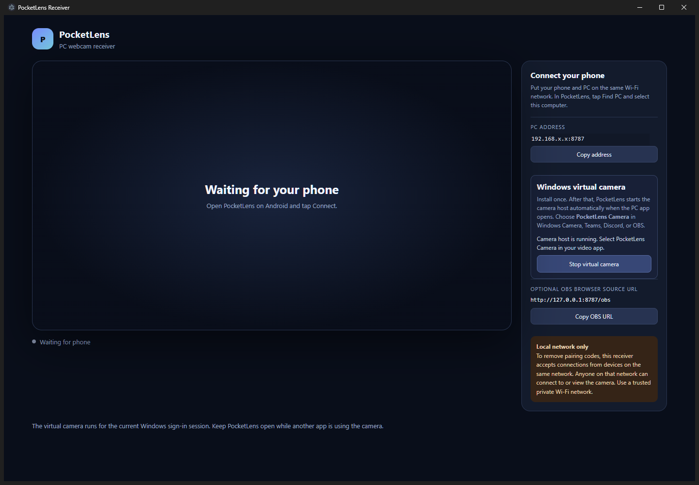

# PocketLens

PocketLens is an original Android-to-PC webcam project. It streams the selected
phone camera over your local Wi-Fi to a Windows receiver.

## PC app preview

The Windows app includes a live camera preview, phone connection details, and
virtual-camera controls.

<p align="center">
  
</p>

## Downloads

The checked-in release files are in [`releases/v1.0.0`](releases/v1.0.0):

- [PocketLens for Windows (portable x64 EXE)](releases/v1.0.0/PocketLens.exe) —
  includes the orientation-restored virtual-camera build.
- [PocketLens for Android (debug APK)](releases/v1.0.0/PocketLens-android-debug.apk) —
  includes 16:9 output selection/cropping and the latest screen-off streaming
  support.

See [`RELEASES.md`](RELEASES.md) for build identifiers, SHA-256 checksums, and
installation notes.

## PC receiver

The PC app has a desktop GUI with a live camera preview, connection status,
copyable PC address, and an optional OBS source URL. Run
`releases/v1.0.0/PocketLens.exe` to open the included release. Connect the
phone and PC to the same Wi-Fi network, then tap **Find PCs** in PocketLens and
select this PC. PocketLens discovers computers using a UDP broadcast on port
8788 and streams over HTTP on port 8787.

To rebuild the Windows `.exe`, install Node.js 24 or later, open PowerShell in
`pc-server`, and run:

```powershell
npm install
npm run build:exe
```

The standalone Windows GUI executable is written to
`pc-server\dist\PocketLens.exe` when built from source and does not require
Node.js on the target PC.
If Windows Firewall prompts, allow PocketLens on a **Private** network so the
phone can reach TCP port 8787 and discover the PC on UDP port 8788.

## Android app

Open the `android` folder in Android Studio with JDK 17 and Android SDK 35
installed. Build and install the `app` configuration, or install the included
`releases/v1.0.0/PocketLens-android-debug.apk`. In PocketLens, tap
**Find PCs**, select your computer, choose the front or back camera, and tap
**Connect camera**. A live camera preview appears in the app; you can change
between the front and rear cameras while streaming without reconnecting to the
PC. The phone automatically rotates captured frames to match its current
portrait or landscape orientation, including when you turn it during a stream.
The camera selection is saved on the phone. Android prompts for camera
permission the first time.

No IP address or pairing code is needed. PocketLens prefers the largest native
16:9 JPEG output available up to 3840×2160 (4K UHD). If the camera only exposes
a 4:3 JPEG stream, PocketLens center-crops it to 16:9 and preserves its EXIF
orientation. Cropping runs asynchronously and drops superseded frames to avoid
building latency. It uses high-quality 90% JPEG compression; actual resolution
depends on the selected camera's supported output sizes. No account or cloud
service is used. While streaming, PocketLens runs a camera
foreground service and holds partial CPU and Wi-Fi locks so capture and transfer
can continue with the phone locked or its display off. Android or the phone
manufacturer may still restrict camera use or background activity; stop the
stream in PocketLens to release these locks.

## Windows virtual camera

The adapted Media Foundation virtual camera is included in the PocketLens PC
app. In the PC app, click **Install virtual camera** once and approve the
administrator prompt. From then on, the camera host starts automatically each
time the PocketLens PC app opens. Connect the phone and select **PocketLens
Camera** in Windows Camera, Teams, Discord, or OBS. Keep the PocketLens PC app
open while using the virtual camera; closing it stops the camera host.

The virtual camera reads the latest PocketLens JPEG frame from the receiver
over a persistent loopback stream and advertises 3840×2160 at 30 fps. The
receiver drops superseded frames rather than building a backlog, and the
camera source decodes each incoming phone frame only once. It applies the
JPEG's EXIF orientation before publishing frames, so Discord and other clients
that do not auto-rotate JPEG metadata display portrait and landscape correctly.
Actual video size and frame rate depend on the phone camera, Wi-Fi throughput,
and client app.
If a video app briefly restarts the Windows camera stream, PocketLens holds
the last good frame for up to two seconds rather than flashing black; it clears
the image if fresh phone frames do not return.
Installing registers the Media Foundation source in the machine-wide COM
registry and copies it to a versioned folder under
`%ProgramFiles%\PocketLens`, where Windows Frame Server can load it. The
adapted source and its MIT license are in
`VCamSample\source\VCamSample-main`.

The upstream sample documents a known Teams issue where local camera preview
may not be transmitted to remote participants.

## Source layout

- `android/` — Kotlin Android application and Gradle project.
- `pc-server/` — local HTTP/UDP receiver, Electron GUI, and receiver tests.
- `VCamSample/source/VCamSample-main/` — adapted Windows Media Foundation
  virtual camera source. Its upstream MIT license is included with the source.
- `releases/v1.0.0/` — the Windows and Android builds shipped with this
  repository.

Build requirements and commands are documented in the Android and PC sections
above. The PC receiver tests run with `npm --prefix pc-server test`.

## Network and privacy

The PC receiver accepts connections from devices on its local network without
a pairing code, as requested. The stream is not encrypted or authenticated:
anyone on the same Wi-Fi/LAN could view or take over the camera connection.
Use PocketLens only on a trusted private network and stop streaming when
finished.
